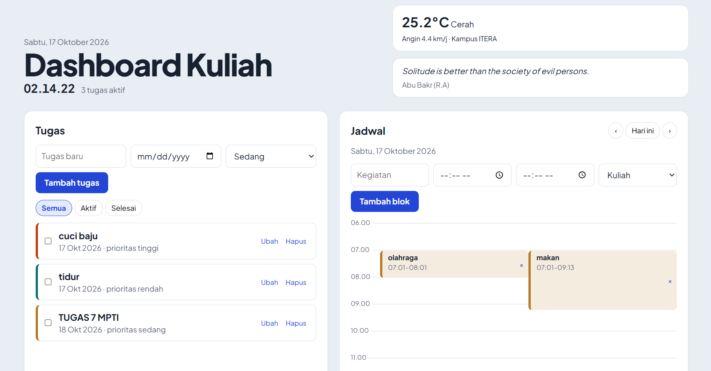
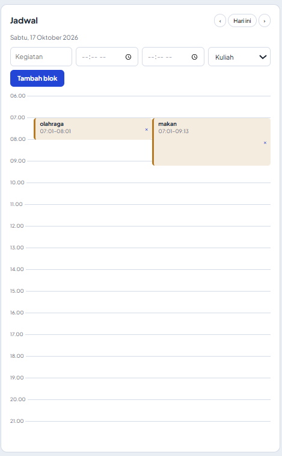
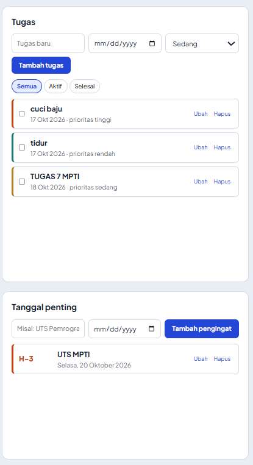
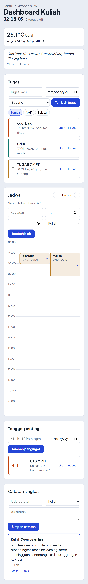

# Dashboard Kuliah

Dashboard pribadi untuk mahasiswa yang menggabungkan daftar tugas bertenggat, jadwal time block, pengingat tanggal penting, dan catatan singkat dalam satu halaman. Dibuat dengan HTML, CSS, dan JavaScript ES6+ (tanpa framework) sebagai Tugas Praktikum Pertemuan 2, Pengembangan Aplikasi Web.

**Nama:** Mega Zayyani
**NIM:** 123140180
**Kelas:** RB

## Latar belakang
Tugas kuliah, jadwal, dan tanggal ujian sering tersebar di banyak tempat. Dashboard ini mengumpulkannya di satu layar agar mudah dilihat setiap hari. Semua data tersimpan di browser (`localStorage`), jadi tidak perlu akun atau server.

## Fitur
| Widget | Fungsi |
|---|---|
| **Tugas** | Tambah, ubah, hapus, tandai selesai. Ada tenggat (tanggal), prioritas, filter Semua/Aktif/Selesai, dan penanda "Terlambat". |
| **Jadwal** | Tampilan harian 06.00–22.00 seperti Google Calendar. Ada navigasi hari, kategori berwarna, garis waktu "sekarang", dan blok yang bertabrakan dibagi menjadi kolom. |
| **Tanggal penting** | Hitung mundur (H-n). Merah jika ≤ 3 hari, pudar jika sudah lewat. |
| **Catatan singkat** | Catatan dengan kategori kuliah atau harian. |
| **Header** | Jam digital, ringkasan tugas aktif/terlambat, cuaca kampus ITERA, dan kutipan harian dari API publik. |

## Screenshot
> Ganti file di folder `docs/` dengan screenshot aplikasimu.

| Tampilan utama | Jadwal time block |
|---|---|
|  |  |

| Tugas dan tanggal penting | Tampilan mobile |
|---|---|
|  |  |

## Cara menjalankan
1. Ekstrak proyek dan **pertahankan struktur folder** (`css/` dan `js/` harus tetap di samping `index.html`).
2. Buka folder di VS Code, klik kanan `index.html`, pilih **Open with Live Server**.
3. Jangan membuka `index.html` dengan double-click. Aplikasi memakai ES Modules (`type="module"`), yang diblokir browser pada protokol `file://`.
4. Butuh koneksi internet agar cuaca, kutipan, dan tugas awal termuat. Tanpa internet, widget menampilkan pesan gagal dan fitur lain tetap berjalan.

## Struktur proyek
```
personal-dashboard/
├── index.html
├── css/style.css
├── docs/                  # screenshot
└── js/
    ├── main.js            # DOM controller: render dan event
    ├── app.js             # class DashboardApp: state, localStorage, fetch
    └── modules/
        ├── models.js      # class Item, TaskItem, TimeBlock, Reminder, Note
        ├── api.js         # pemanggilan API publik
        └── utils.js       # helper tanggal, escapeHtml, dll.
```

## Arsitektur
- **`TaskItem`** (dan model lain) memodelkan struktur data tiap item. `TaskItem` memiliki getter `isOverdue`.
- **`DashboardApp`** mengelola state, operasi CRUD, penyimpanan `localStorage`, dan pemanggilan `fetch()` data eksternal.
- **State immutable**: setiap perubahan membuat array baru dengan spread (`[...list, item]`, `{ ...state, [key]: list }`), bukan mengubah array lama.
- **`main.js`** hanya menangani tampilan dan event. Satu event listener pada `document` menangani semua tombol ubah, hapus, dan centang (event delegation).
- Data pengguna di-escape (`escapeHtml`) sebelum dirender lewat template literal untuk mencegah XSS.

## API publik yang dipakai
| API | Endpoint | Dipakai untuk |
|---|---|---|
| Open-Meteo | `api.open-meteo.com/v1/forecast?latitude=-5.36&longitude=105.31&current_weather=true` | Cuaca di kampus ITERA (header) |
| DummyJSON | `dummyjson.com/quotes/random` | Kutipan harian (header) |
| JSONPlaceholder | `jsonplaceholder.typicode.com/todos?_limit=5` | Mengisi 5 tugas awal satu kali saat pertama dibuka |

Cuaca dan kutipan dipanggil bersamaan dengan `Promise.allSettled`, sehingga kegagalan satu API tidak membuat yang lain ikut gagal.

## Fitur ES6+ dan lokasinya
| Fitur | File | Baris |
|---|---|---|
| `let` dan `const` | js/main.js | 6–11 (`const app`, `let selectedDate`) |
| Arrow functions (lebih dari 3) | js/modules/utils.js | 2, 4, 6, 8, 13, 17, 22, 26 |
| Arrow functions di callback | js/main.js | 7, 21, 31, 35, 44, 54, 55 |
| Template literals | js/main.js | 21–27 (`taskHTML`), 54–55 (jadwal) |
| Async/await | js/modules/api.js | 8–12 (`getJSON`), 14–17, 19–22, 24–27 |
| Async/await di app | js/app.js | 70–73 (`seedIfEmpty`), 85–86 (`loadWidgets`) |
| Promise (`Promise.allSettled`) | js/app.js | 86 |
| Classes | js/modules/models.js | 4–8 (`Item`), 10–19 (`TaskItem`), 21–40 (model lain) |
| Inheritance (`extends`, `super`) | js/modules/models.js | 10, 21, 28, 35 |
| Class pengelola aplikasi | js/app.js | 9 (`DashboardApp`) |
| Getter | js/app.js, js/modules/models.js | app.js 56, 65; models.js 15 |
| Private method (`#load`) | js/app.js | 11, 14 |
| Destructuring pada parameter fungsi | js/main.js | 21, 55 |
| Destructuring objek bertingkat | js/modules/api.js | 15, 20, 25–26 |
| Destructuring array | js/modules/utils.js, js/app.js | utils.js 9; app.js 22, 86 |
| Spread (state immutable) | js/app.js | 35, 41, 42, 47, 78 |
| Rest | js/main.js | 135 (`const { id, ...fields }`) |
| Array methods (`map`, `filter`, `find`, `sort`) | js/app.js | 23, 41, 47, 52, 58, 62 |
| Optional chaining dan nullish `??` | js/modules/utils.js, js/app.js | utils.js 4; app.js 17, 23 |
| Default parameter | js/modules/utils.js, js/modules/models.js | utils.js 6, 26; models.js 11 |
| `for...of` dan `Object.entries` | js/app.js | 22 |
| ES Modules (`import`/`export`) | semua file di js/ | baris awal tiap file |
| `localStorage` | js/app.js | 17 (baca), 29 (simpan) |

## Catatan pengembangan
- Tenggat tugas hanya berupa tanggal, jadi tugas yang jatuh tempo hari ini belum dianggap terlambat.