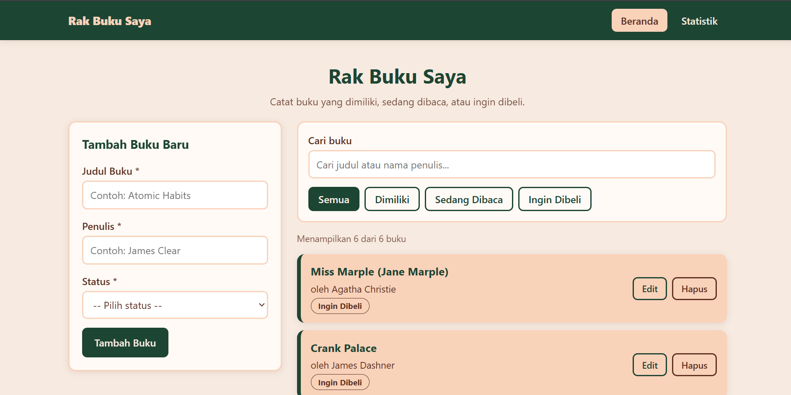
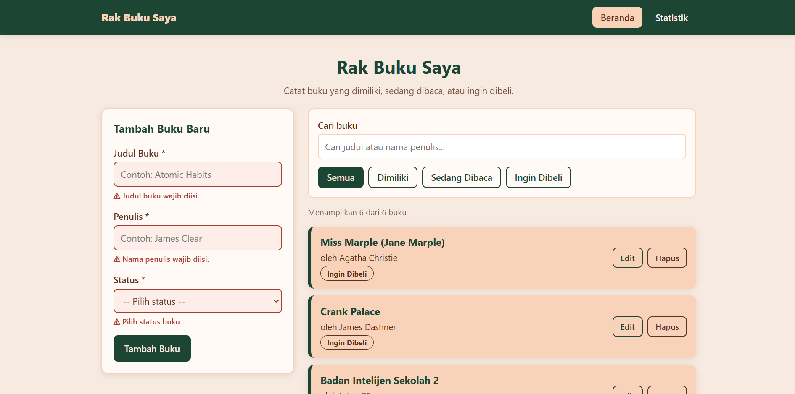
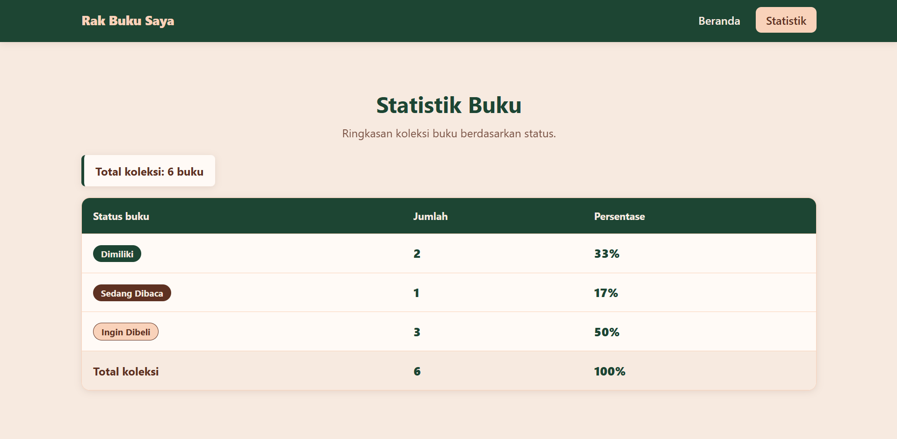
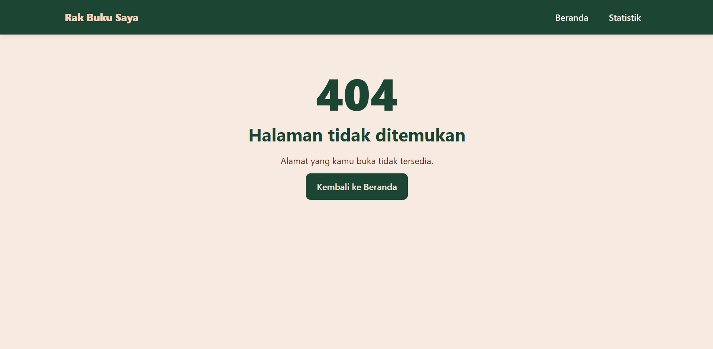
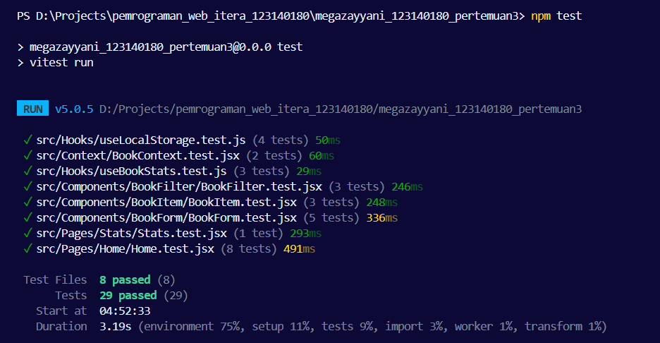

# 📚 Rak Buku Saya
## Aplikasi Manajemen Buku Pribadi

Praktikum Pengembangan Aplikasi Web (PAW) Pertemuan 3

| | |
|---|---|
| Nama | Mega Zayyani |
| NIM | 123140180 |

## 1. Deskripsi Aplikasi

**Rak Buku Saya** adalah aplikasi web untuk mencatat buku pribadi. Setiap buku punya **judul**, **penulis**, dan **status**:

- **Dimiliki** (`milik`) : buku yang sudah ada di rak,
- **Sedang Dibaca** (`baca`) : buku yang sedang dibaca,
- **Ingin Dibeli** (`beli`) : buku yang masuk wishlist.

Data disimpan di **localStorage** sehingga tetap ada walau halaman di-refresh atau browser ditutup.

### Fitur
- Tambah buku baru (dengan validasi kolom wajib isi + feedback visual)
- Edit buku (form yang sama berubah ke mode edit)
- Hapus buku (dengan dialog konfirmasi)
- Pencarian berdasarkan judul atau nama penulis (tidak case-sensitive)
- Filter berdasarkan status (Semua / Dimiliki / Sedang Dibaca / Ingin Dibeli)
- Halaman **Statistik** (total & persentase tiap status)
- Navigasi multi-halaman: `/` (Beranda), `/stats` (Statistik), `*` (404)

## 2. Instalasi & Cara Menjalankan

Prasyarat: **Node.js ≥ 20** dan npm.

```bash
# 1. masuk ke folder project
cd megazayyani_123140180_pertemuan3

# 2. pasang dependensi
npm install

# 3. jalankan mode pengembangan  -> buka http://localhost:5173
npm run dev

# 4. jalankan unit test
npm test

# (opsional) build produksi & cek lint
npm run build
npm run lint
```

## 3. Screenshot Antarmuka

| Nama halaman | Gambar |
|---|---|
| Beranda |  |
| Validasi form |  |
| Statistik |  |
| Not Found |  |

## 4. Struktur Folder

```
src/
├── Components/
│   ├── Header/
│   │   ├── Header.jsx
│   │   └── Header.css
│   ├── Navbar/
│   │   ├── Navbar.jsx
│   │   └── Navbar.css
│   ├── BookForm/     form tambah & edit + validasi
│   ├── BookList/     daftar + pesan kosong
│   ├── BookItem/     satu kartu buku
│   └── BookFilter/   pencarian + filter status
├── Pages/
│   ├── Home/         halaman utama
│   ├── Stats/        statistik buku
│   └── NotFound/     halaman 404
├── Hooks/            custom hook
├── Context/          state dan aksi koleksi buku
├── constants/        status buku + PropTypes shape
├── App.jsx
├── index.css
└── main.jsx
setupTests.js         setup matcher untuk unit test
```

## 5. Penjelasan Fitur React yang Digunakan

| Konsep | Di mana | Penjelasan |
|---|---|---|
| **useState** | `BookForm`, `Home`, `BookContext`, `useLocalStorage` | Menyimpan nilai input form, daftar error, buku yang sedang diedit, pesan sukses, serta filter & kata kunci pencarian. |
| **useEffect** | `useLocalStorage`, `Home`, `Stats` | (1) menyimpan data ke localStorage setiap `books` berubah, (2) mengubah `document.title` per halaman, (3) menghapus pesan sukses otomatis setelah 3 detik **dengan cleanup** `clearTimeout`. |
| **Context API** | `context/BookContext.jsx` | `BookProvider` menyimpan `books`, `filteredBooks`, `addBook`, `updateBook`, `deleteBook`, filter, dan pencarian. Halaman mengambilnya lewat `useBooks()` tanpa *props drilling*. |
| **React Router** | `App.jsx`, `Navbar.jsx` | `BrowserRouter`, `Routes`/`Route` untuk `/`, `/stats`, dan `*` (404); `NavLink` memberi class `active` pada menu aktif. |
| **Custom hook #1** | `useLocalStorage` | Seperti `useState` tetapi tersinkron dengan localStorage; aman terhadap JSON rusak (try/catch). |
| **Custom hook #2** | `useBookStats` | Menghitung total, jumlah, dan persentase buku per status untuk halaman Statistik. |
| **Komponen reusable** | `BookForm`, `BookItem`, `BookFilter`, `BookList`, `Header` | `BookForm` dipakai untuk mode tambah **dan** edit; `BookItem` dipakai ulang oleh `BookList` untuk setiap buku. |
| **PropTypes** | semua komponen & `BookProvider` | Seluruh komponen punya `propTypes`; bentuk objek buku dibagi lewat `bookShape` di `constants/bookStatus.js`. |
| **Controlled component** | `BookForm`, `BookFilter` | Nilai input dikendalikan state React (`value` + `onChange`). |
| **Conditional & list rendering** | `BookList`, `Home`, `Stats` | `map` + `key` untuk daftar, kondisional untuk pesan kosong / notifikasi. |

### Penyimpanan (localStorage)
Kunci: **`books_data`**. Contoh isi:
```json
[{ "id": "1730000000000-a1b2c3", "title": "Atomic Habits", "author": "James Clear", "status": "baca", "createdAt": 1730000000000 }]
```

### Error Handling Form
- Judul, Penulis, dan Status **wajib diisi**, input yang hanya berisi spasi juga ditolak.
- Feedback visual: border merah + latar kemerahan pada input, pesan `⚠ ...` di bawahnya (`role="alert"`), dan atribut `aria-invalid`.
- Pesan error hilang otomatis saat pengguna mulai memperbaiki kolom tersebut.

## 6. Laporan Testing

Dijalankan dengan **Vitest + React Testing Library** (`npm test`): **7 file test, 28 test case** (syarat minimal 5).

| File test | Yang diuji |
|---|---|
| `BookForm.test.jsx` | validasi kosong, `aria-invalid`, input spasi, submit ter-*trim* & form reset, mode edit + batal |
| `BookItem.test.jsx` | tampilan judul/penulis/status, klik Edit, klik Hapus |
| `BookFilter.test.jsx` | input pencarian, klik filter status, `aria-pressed` |
| `Home.test.jsx` (integrasi) | tambah, filter, cari (judul & penulis), edit, hapus (konfirmasi ya/tidak), jumlah hasil, persistensi localStorage |
| `useLocalStorage.test.js` | nilai awal, baca, simpan, JSON rusak |
| `useBookStats.test.js` | total, persentase, daftar kosong |
| `BookContext.test.jsx` | Provider menyediakan data, error bila dipakai di luar Provider |

📸 **Screenshot hasil eksekusi test:**



## 7. Catatan Kode
Komentar berbahasa Indonesia ada di bagian-bagian penting: validasi (`BookForm`), sinkronisasi localStorage (`useLocalStorage`), logika filter/pencarian dan CRUD (`BookContext`), serta `useEffect` + cleanup (`Home`).